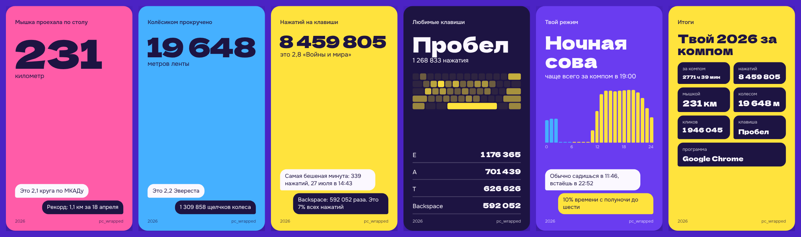
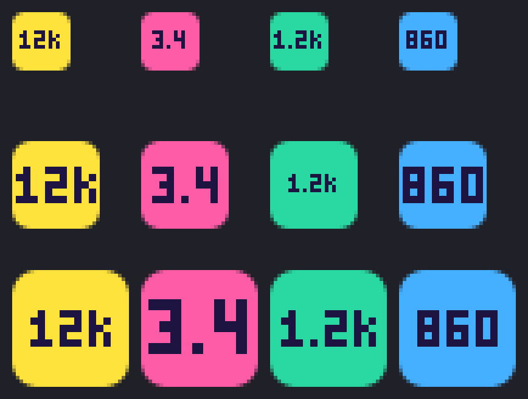
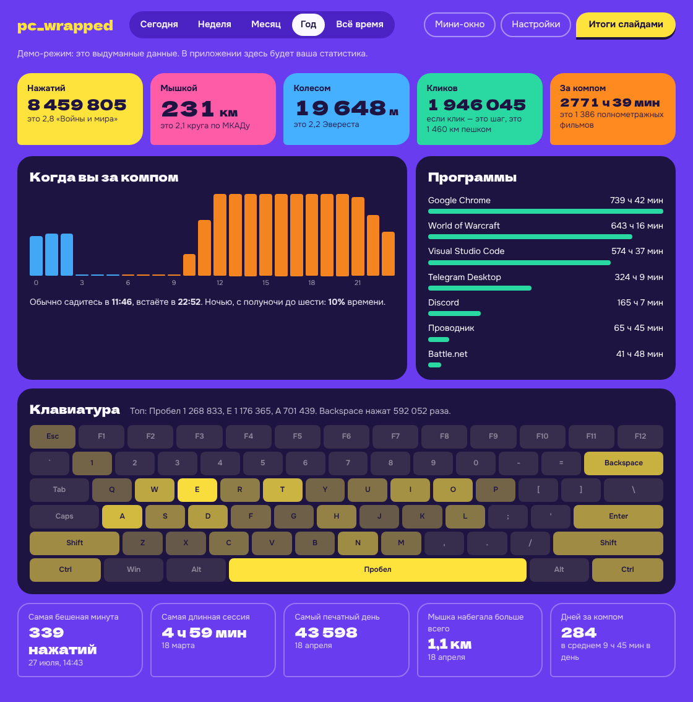

# pc_wrapped

Весёлая статистика твоего компьютера. Программа тихо живёт в трее и считает: сколько
километров проехала мышка, сколько метров ленты прокручено колесом, сколько раз нажата
каждая клавиша, где проходит время. Цифры видно прямо в трее, как у Afterburner, и в
маленьком окошке поверх всех окон. А в конце дня, недели или года — итоги слайдами в
стиле Spotify Wrapped, которые можно сохранить картинкой.



## Что считает

- **Мышка:** путь по столу в километрах («это 2 круга по МКАДу»), клики левой и остальными.
- **Колесо:** метры прокрутки («это 2 Эвереста»).
- **Клавиатура:** нажатия всего и по каждой клавише, тепловая карта, любимая клавиша,
  сколько раз нажат Backspace, самая бешеная минута.
- **Время:** сколько за компом (простой дольше двух минут не считается), в каких программах,
  во сколько обычно садишься и встаёшь, самая длинная сессия без перерыва, сова или жаворонок.
- **Рекорды:** самый печатный день, день, когда мышка набегала больше всего.

## Цифры в трее и мини-окно

Каждый счётчик за сегодня — отдельный значок с цифрой рядом с часами: `12k` нажатий,
`3.4` км мышкой и так далее. Какие показывать, выбирается в настройках. Наведи на значок —
увидишь полное число.



В Windows 11 новые значки сначала прячутся под стрелку «^» рядом с часами. Перетащи их
на панель задач, и они останутся там.

Мини-окно — маленькая плашка поверх всех окон с четырьмя живыми счётчиками. Двигается
мышкой, может пропускать клики сквозь себя. Открывается и закрывается из меню трея.



## Уведомления и экспорт

- **Итоги недели и месяца** — маленькая карточка справа снизу в понедельник и первого числа,
  клик открывает слайды. Фокус не забирает, поверх игр и полноэкранного видео не показывается.
- **Напоминание о перерыве** после часа (настраивается) за компом без отдыха. Выключено по умолчанию.
- **Сравнение с собой:** на плитках ▲/▼ против обычного дня к этому часу или прошлой недели и месяца.
- **Слайды картинкой** — сохранить PNG или скопировать в буфер; **CSV по дням** открывается в Excel.
  Файлы ложатся в подпапку `exports` рядом с данными.

## Приватность и производительность

- **Это не кейлоггер.** Программа не знает, что ты печатаешь: хранится только количество
  нажатий по каждой клавише. Никаких текстов, паролей, скриншотов.
- **Всё локально.** Данные лежат в обычных JSON-файлах по дням в папке, которую выбираешь при первом
  запуске (по умолчанию предлагается несистемный диск, сменить можно в настройках).
  Программа ничего никуда не отправляет, сетевых запросов в ней нет.
- **Не мешает в играх.** Ввод читается через Raw Input, а не через глобальные хуки:
  программа получает копию событий и не встаёт в цепочку обработки нажатий, поэтому задержки ввода нет.
- **Лёгкая.** В фоне работает только Rust: в памяти копятся счётчики, раз в минуту они пишутся на диск.
  Окно на WebView создаётся только когда его открываешь, а при закрытии полностью выгружается.

## Установка

Скачай `pc_wrapped_x.y.z_x64-setup.exe` со страницы [Releases](../../releases) и запусти.
Установщик не подписан, поэтому SmartScreen может предупредить: **Подробнее → Выполнить в любом случае**.

В настройках можно включить автозапуск вместе с Windows: программа стартует тихо, сразу в трей.

### Точность километров

Мышка сообщает движение в «точках» своего сенсора. Чтобы перевести их в сантиметры,
нужен DPI мышки: по умолчанию 800, поменять можно в настройках. Точное значение есть в
программе от производителя мышки или на коробке.

## Сборка из исходников

Нужны [Node.js](https://nodejs.org) 20+, [Rust](https://rustup.rs) (stable, MSVC) и
[зависимости Tauri для Windows](https://tauri.app/start/prerequisites/).

```bash
npm install
npm run app       # приложение в режиме разработки
npm run dev       # только интерфейс в браузере на выдуманных данных: http://localhost:1431
npm test          # тесты подсчётов (vitest)
npm run release   # установщик в src-tauri/target/release/bundle/nsis
```

Тесты Rust-части: `cd src-tauri && cargo test`.

## Устройство

- **Tauri 2 + Rust** — фоновая часть:
  - `src-tauri/src/win.rs` — Raw Input в невидимом окне, активная программа и её название из exe;
  - `tracker.rs` — счётчики текущего дня, сессии, смена суток;
  - `store.rs` — JSON-файлы по дням с атомарной записью;
  - `font.rs` — свой пиксельный шрифт 3×5 для цифр в значках трея;
  - `lib.rs` — трей, окна, команды для интерфейса.
- **Svelte 5 + TypeScript** — окно статистики, мини-окно и слайды (`src/`). Сводка за период
  считается в `src/lib/aggregate.ts`, перевод чисел в понятные сравнения — в `src/lib/fun.ts`.

## Лицензия

[PolyForm Noncommercial 1.0.0](LICENSE.md): пользоваться, изучать, менять и делиться можно
бесплатно, но только в некоммерческих целях. Продавать программу или использовать её в
коммерческой деятельности нельзя без отдельного разрешения автора.

Шрифты и библиотеки — под своими лицензиями, см. [NOTICE.md](NOTICE.md).
